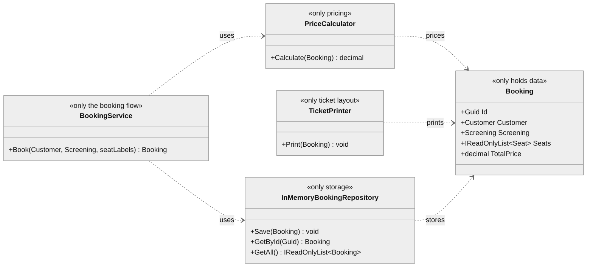
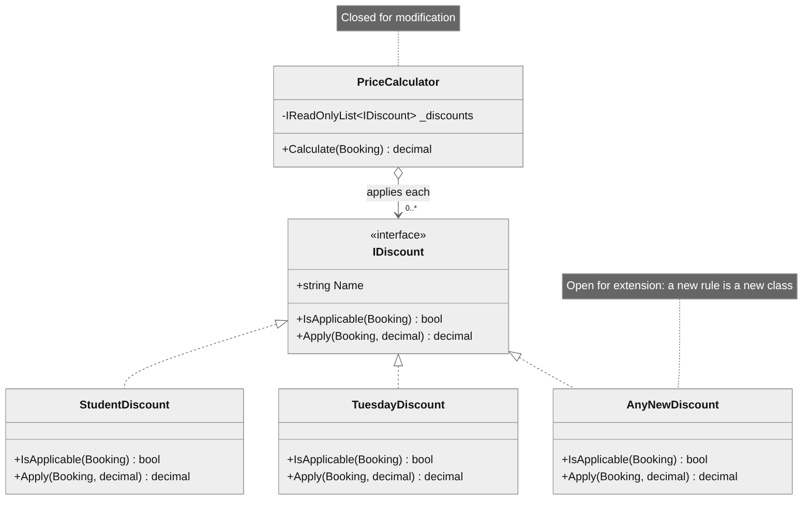
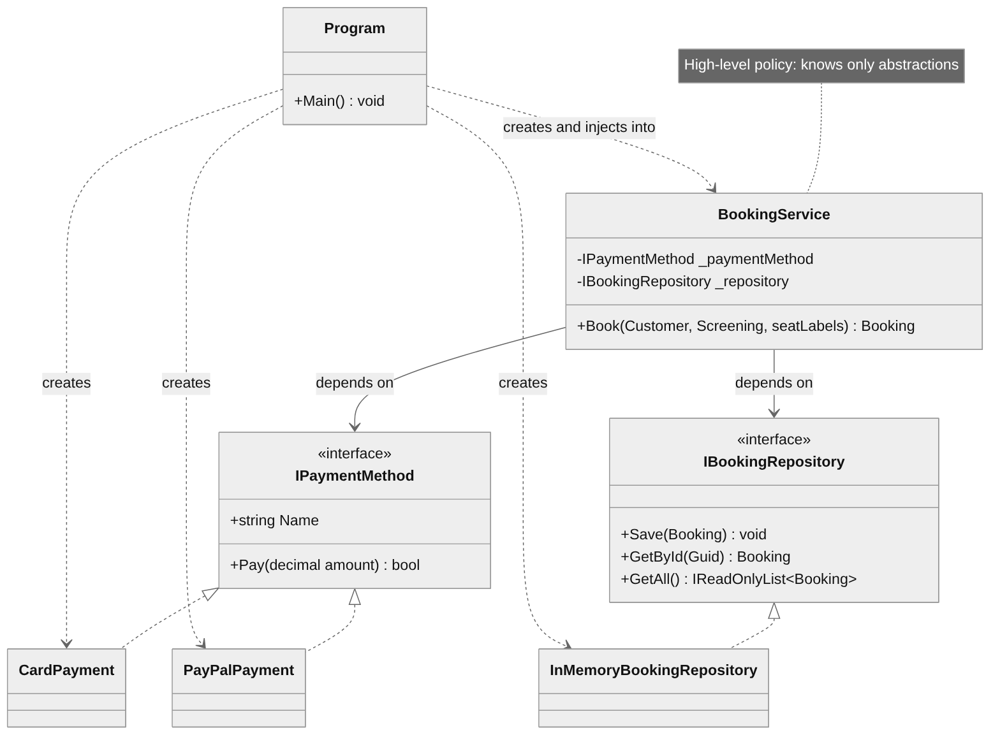

# Laboratory Work 0 — SOLID Principles

**Course:** Tehnici și Mecanisme de Proiectare Software (TMPS)
**Author:** Teodor Strulea, FAF-242
**Language:** C# (.NET 8)
**Project:** Cinema Booking System

## Objectives

1. Choose a simple domain for a semester-long pet project.
2. Study the SOLID principles.
3. Implement the project's core while applying three of the principles.

Principles applied in this laboratory work: **Single Responsibility (SRP)**,
**Open/Closed (OCP)** and **Dependency Inversion (DIP)**.

## Theory

SOLID is a set of five object-oriented design principles whose shared goal is
code that can change without breaking: each class has one job (S), new
behaviour is added by writing new code instead of editing working code (O),
subtypes can stand in for their base types (L), interfaces stay small (I), and
high-level logic depends on abstractions instead of concrete details (D).

## The project

A **cinema ticket booking system**. Customers pick a screening, choose seats,
get discounts applied, pay, and receive a ticket. The domain is deliberately
simple so that the focus stays on *how* the code is designed rather than
*what* it does.

```
CinemaBooking/
├── Program.cs                      composition root + demo scenarios
├── Domain/                         data classes that guard only their own invariants
│   ├── Movie.cs
│   ├── Screening.cs
│   ├── Seat.cs
│   ├── Customer.cs
│   └── Booking.cs
├── Discounts/                      OCP: pluggable pricing rules
│   ├── IDiscount.cs
│   ├── StudentDiscount.cs
│   └── TuesdayDiscount.cs
├── Payments/                       DIP: pluggable payment methods
│   ├── IPaymentMethod.cs
│   ├── CardPayment.cs
│   └── PayPalPayment.cs
├── Repositories/                   DIP: pluggable storage
│   ├── IBookingRepository.cs
│   └── InMemoryBookingRepository.cs
└── Services/                       SRP: one job per class
    ├── PriceCalculator.cs
    ├── TicketPrinter.cs
    └── BookingService.cs
```

## Implementation

### 1. Single Responsibility Principle (SRP)

> A class should have only one reason to change.

`Booking` holds the booking data and nothing else. It does not know how to
price itself, store itself or print itself. Each of those concerns has its own
class:

| Class                       | Its one job                                  |
|-----------------------------|----------------------------------------------|
| `Booking`                   | hold the customer, screening and seats       |
| `PriceCalculator`           | work out the total cost                      |
| `InMemoryBookingRepository` | store and retrieve bookings                  |
| `TicketPrinter`             | format and print a ticket                    |
| `BookingService`            | orchestrate the booking flow                 |

If the ticket layout changes, only `TicketPrinter` is touched. If storage
moves to a database, only the repository changes.

<p align="center"></p>

### 2. Open/Closed Principle (OCP)

> Software entities should be open for extension but closed for modification.

Discounts are expressed through the `IDiscount` interface:

```csharp
public interface IDiscount
{
    string Name { get; }
    bool IsApplicable(Booking booking);
    decimal Apply(Booking booking, decimal currentPrice);
}
```

`PriceCalculator` simply iterates over the discounts it is given:

```csharp
foreach (var discount in _discounts)
{
    if (discount.IsApplicable(booking))
        price = discount.Apply(booking, price);
}
```

To add a new rule — say a `SeniorDiscount` — you write a new class and
register it in `Program.cs`. `PriceCalculator` is never edited.

<p align="center"></p>

### 3. Dependency Inversion Principle (DIP)

> High-level modules should not depend on low-level modules; both should
> depend on abstractions.

`BookingService` is the high-level policy. It receives everything it needs
through its constructor as abstractions:

```csharp
public BookingService(
    PriceCalculator priceCalculator,
    IBookingRepository repository,
    IPaymentMethod paymentMethod)
```

It has no idea whether the money comes from a card or PayPal, or whether
bookings live in memory or in SQL. The concrete classes are chosen in one
place (`Program.cs`, the composition root) and injected. The demo runs the
same `BookingService` class once with `CardPayment` and once with
`PayPalPayment` without a single line of the service changing.

<p align="center"></p>

## Results

Requires the [.NET 8 SDK](https://dotnet.microsoft.com/download) or newer.

```bash
cd CinemaBooking
dotnet run
```

The demo runs three scenarios: a student booking two seats by card, a regular
customer booking on a Tuesday with PayPal, and an attempt to double-book a
seat that is correctly rejected.

## Conclusions

- **SRP** made every class short and easy to name: when a requirement
  changes, there is one obvious place to edit.
- **OCP** turned "add a discount" from an edit inside the pricing logic into
  a new, isolated class.
- **DIP** decoupled the booking flow from payment and storage details, so
  either can be replaced without touching `BookingService`.
- Together they give the project a base that can grow in small steps without
  rewriting what already works.
