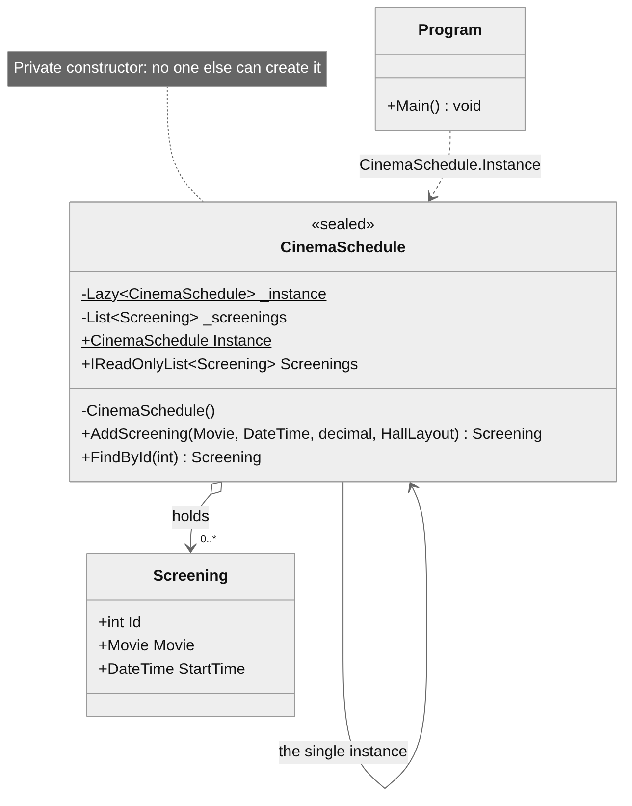
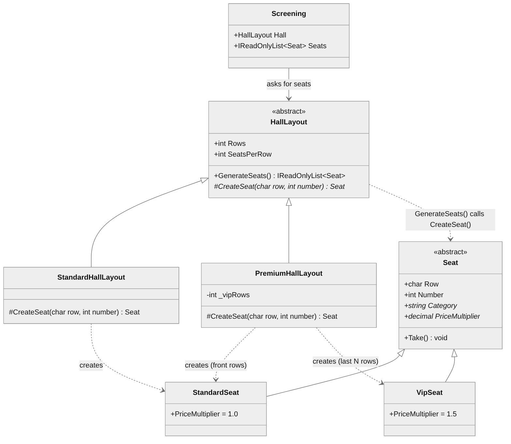
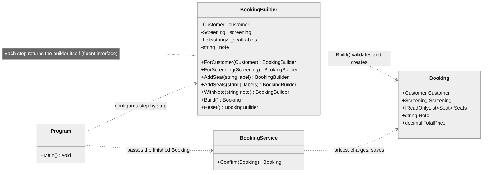

# Laboratory Work 1 — Creational Design Patterns

**Course:** Tehnici și Mecanisme de Proiectare Software (TMPS)
**Author:** Teodor Strulea, FAF-242
**Language:** C# (.NET 8)
**Project:** Cinema Booking System

## Objectives

1. Study the creational design patterns and understand what problem each one solves.
2. Choose three of them and implement them in the semester project.
3. Use each pattern where the project has a real need for it, not for its own sake.

Patterns implemented in this laboratory work: **Singleton**, **Factory Method** and **Builder**.

## Theory

Creational patterns deal with *how objects get created*. Calling `new` on
concrete classes all over the code ties every caller to those classes. These
patterns move the decision of *which* class to create, *how* to assemble it
and *how many* instances may exist into one well-defined place.

## The project

A cinema ticket booking system: customers pick a screening, choose seats, get
discounts applied, pay, and receive a ticket.

```
CinemaBooking/
├── Program.cs                      composition root + demo of the three patterns
├── Domain/
│   ├── Movie.cs
│   ├── Screening.cs
│   ├── Seat.cs                     abstract product (Factory Method)
│   ├── StandardSeat.cs             concrete product
│   ├── VipSeat.cs                  concrete product
│   ├── Customer.cs
│   └── Booking.cs
├── Halls/                          FACTORY METHOD
│   ├── HallLayout.cs               abstract creator with CreateSeat()
│   ├── StandardHallLayout.cs       concrete creator
│   └── PremiumHallLayout.cs        concrete creator
├── Schedule/                       SINGLETON
│   └── CinemaSchedule.cs
├── Builders/                       BUILDER
│   └── BookingBuilder.cs
├── Discounts/                      IDiscount and its implementations
├── Payments/                       IPaymentMethod and its implementations
├── Repositories/                   IBookingRepository, InMemoryBookingRepository
└── Services/                       PriceCalculator, TicketPrinter, BookingService
```

## Implementation

### 1. Singleton — `CinemaSchedule`

**Problem.** The cinema has exactly one timetable. If two parts of the app
each built their own list of screenings, they would also each have their own
copy of the seats, and two customers could end up with the same seat.

**Solution.** `CinemaSchedule` can only be reached through
`CinemaSchedule.Instance`:

```csharp
public sealed class CinemaSchedule
{
    private static readonly Lazy<CinemaSchedule> _instance = new(() => new CinemaSchedule());
    public static CinemaSchedule Instance => _instance.Value;

    private CinemaSchedule() { }
    ...
}
```

- the **private constructor** makes `new CinemaSchedule()` a compile error
  anywhere else;
- **`Lazy<T>`** creates the instance on first use and is thread-safe by
  default, so no hand-written locking is needed;
- **`sealed`** prevents a subclass from smuggling in a second instance.

The demo fetches `Instance` twice, shows `ReferenceEquals` is `true`, then
adds a screening through one reference and reads the new count through the
other.

<p align="center"></p>

### 2. Factory Method — `HallLayout.CreateSeat()`

**Problem.** If `Screening` builds its own seats with `new Seat(...)` in a
loop, introducing VIP seats means putting `if (isVipRow)` logic inside
`Screening`, and every new seat type grows that `if` chain.

**Solution.** Seat creation is delegated to a *creator* hierarchy.
`HallLayout.GenerateSeats()` holds the shared algorithm (walk rows × numbers)
and calls the abstract `CreateSeat(row, number)` for each position. Each
subclass overrides only that one method:

```csharp
public abstract class HallLayout
{
    protected abstract Seat CreateSeat(char row, int number);     // the factory method

    public IReadOnlyList<Seat> GenerateSeats()
    {
        var seats = new List<Seat>(Rows * SeatsPerRow);
        for (int r = 0; r < Rows; r++)
            for (int n = 1; n <= SeatsPerRow; n++)
                seats.Add(CreateSeat((char)('A' + r), n));
        return seats;
    }
}

public class PremiumHallLayout : HallLayout
{
    protected override Seat CreateSeat(char row, int number) =>
        (row - 'A') >= Rows - _vipRows ? new VipSeat(row, number) : new StandardSeat(row, number);
}
```

`Screening` just receives a `HallLayout` and asks it for seats; it never
names a concrete seat class. A new kind of hall is one new subclass.

A side benefit: each `Seat` subclass carries its own `PriceMultiplier`, so
`PriceCalculator` prices a VIP seat correctly without knowing VIP exists.

<p align="center"></p>

| Role              | Class                                      |
|-------------------|--------------------------------------------|
| Creator           | `HallLayout`                               |
| Concrete creators | `StandardHallLayout`, `PremiumHallLayout`  |
| Product           | `Seat`                                     |
| Concrete products | `StandardSeat`, `VipSeat`                  |

### 3. Builder — `BookingBuilder`

**Problem.** A booking is assembled gradually: the customer is known first,
then the screening, then seats are clicked one at a time, then maybe a note.
Squeezing all of that into a single method such as
`BookingService.Book(customer, screening, seatLabels)` mixes *construction*
with *processing*, and leaves no good place for validation.

**Solution.** A fluent builder collects the parts and validates them once,
in `Build()`:

```csharp
var booking = new BookingBuilder()
    .ForCustomer(ana)
    .ForScreening(schedule.FindById(1)!)
    .AddSeat("B3")
    .AddSeat("C3")
    .WithNote("Birthday outing")
    .Build();          // throws if anything is missing or a seat is invalid

bookingService.Confirm(booking);   // price -> pay -> reserve -> save
```

`Build()` checks that a customer and a screening were set, that at least one
seat was added, that no seat was added twice, that every seat exists in the
hall, and that none is already taken. A `Booking` object therefore can never
exist in a half-built or invalid state, and `BookingService` is left with its
real job: pricing, payment, reservation and persistence.

<p align="center"></p>

### Patterns considered but not used

- **Abstract Factory** would make sense once halls need *families* of
  related objects (seats + screen + sound system), not just seats.
- **Prototype** fits cloning a template `Screening` across a week of
  identical time slots.
- **Object Pool** is unnecessary here; seat objects are cheap to create.

## Results

Requires the [.NET 8 SDK](https://dotnet.microsoft.com/download) or newer.

```bash
cd CinemaBooking
dotnet run
```

The demo walks through the three patterns in order: proves the schedule is a
single shared instance, prints the seat types each hall layout produced, then
builds and confirms two bookings (one with a VIP seat and a student discount,
one on a Tuesday via PayPal) and shows four invalid bookings being rejected
by the builder.

## Conclusions

- **Singleton** guarantees one shared schedule and one seat state for the
  whole application. It is used only for something that is singular by
  nature, since a singleton is in effect global state.
- **Factory Method** moved the choice of seat type out of `Screening` and
  into the hall layouts, so new hall and seat types are added as new classes.
- **Builder** separated assembling a booking from processing it and put all
  validation in one place, so an invalid `Booking` cannot be created.
- In all three cases object creation ended up behind a single, named place
  instead of `new` calls spread through the code.
