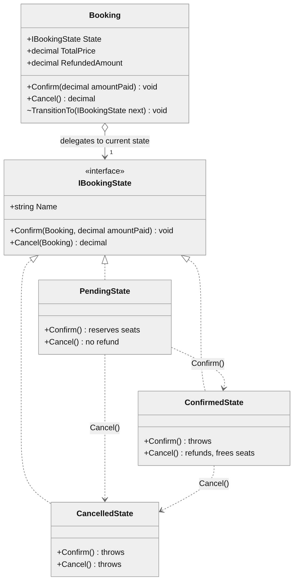
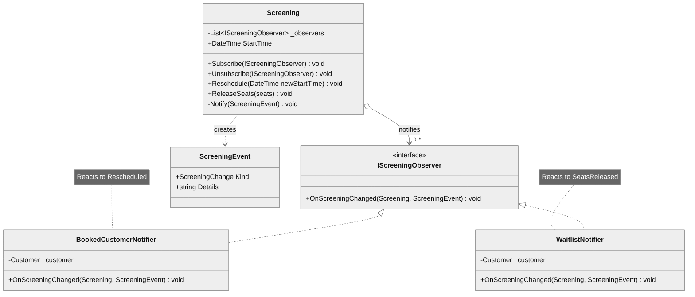
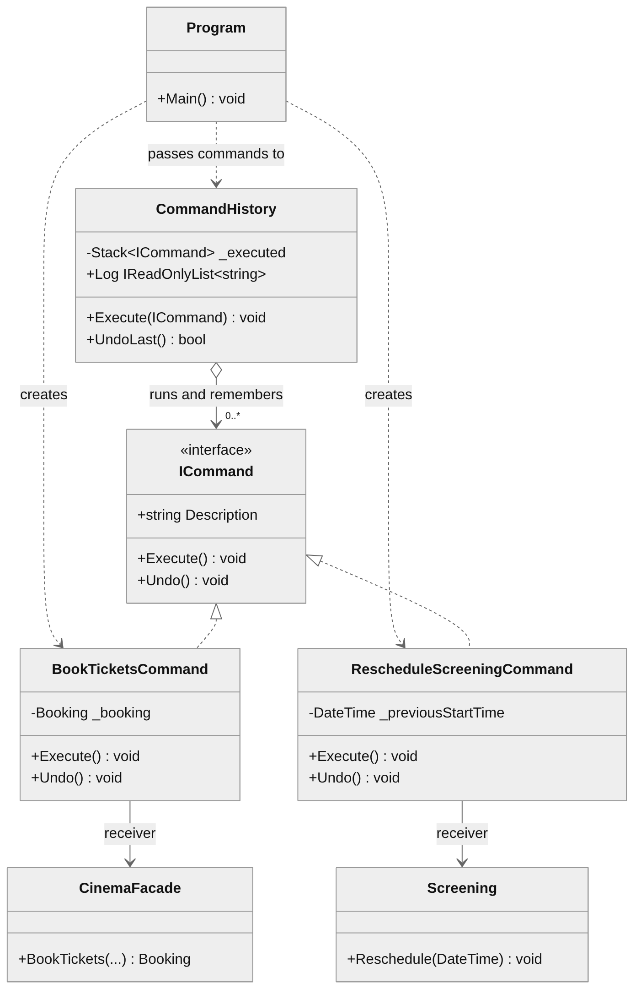

# Laboratory Work 3 — Behavioral Design Patterns

**Course:** Tehnici și Mecanisme de Proiectare Software (TMPS)
**Author:** Teodor Strulea, FAF-242
**Language:** C# (.NET 8)
**Project:** Cinema Booking System

## Objectives

1. Study the behavioral design patterns and understand what problem each one solves.
2. Choose three of them and implement them in the semester project.
3. Keep the existing code working: the new patterns must plug into the
   project instead of replacing it.

Patterns implemented in this laboratory work: **State**, **Observer** and **Command**.

## Theory

Behavioral patterns describe how objects *communicate* and how
responsibilities are divided between them. They take behaviour that would
otherwise sit in long conditionals or in tightly coupled classes and give it
its own objects: one object per stage of a lifecycle (State), a subscription
list instead of hard-wired calls (Observer), a request turned into an object
that can be stored and reversed (Command).

## The project

A cinema ticket booking system: customers pick a screening, choose seats, get
discounts applied, optionally add extras, pay, and receive a ticket. In this
laboratory work bookings gain a lifecycle, screenings announce their changes,
and actions can be undone.

```
CinemaBooking/
├── Program.cs                      composition root + demo of the three patterns
├── Domain/
│   ├── Booking.cs                  STATE: the context
│   ├── Screening.cs                OBSERVER: the subject
│   └── Movie.cs, Seat.cs, StandardSeat.cs, VipSeat.cs, Customer.cs
├── States/                         STATE
│   ├── IBookingState.cs            state interface
│   ├── PendingState.cs             concrete states
│   ├── ConfirmedState.cs
│   └── CancelledState.cs
├── Notifications/                  OBSERVER
│   ├── IScreeningObserver.cs       observer interface (+ ScreeningEvent)
│   ├── BookedCustomerNotifier.cs   concrete observers
│   └── WaitlistNotifier.cs
├── Commands/                       COMMAND
│   ├── ICommand.cs                 command interface
│   ├── BookTicketsCommand.cs       concrete commands
│   ├── RescheduleScreeningCommand.cs
│   └── CommandHistory.cs           invoker
├── Halls/, Schedule/, Builders/    hall layouts, schedule, BookingBuilder
├── Discounts/, Payments/, Orders/  pricing rules, payment methods, order extras
├── Repositories/, Services/        storage, PriceCalculator, TicketPrinter, BookingService
└── Facade/                         CinemaFacade
```

## Implementation

### 1. State — booking lifecycle

**Problem.** A booking is not always in the same condition: it is first
*pending* (built, not paid), then *confirmed* (paid, seats reserved), and may
end up *cancelled*. The same request means different things at each stage:
cancelling an unpaid booking costs nothing, cancelling a paid one means a
refund and freeing the seats, and cancelling a cancelled one is an error.
Written inside `Booking`, this becomes a `switch (status)` in every method,
and every new status edits all of them.

**Solution.** Each stage is a class implementing `IBookingState`. `Booking`
(the context) holds the current state object and forwards the calls to it:

```csharp
public class Booking
{
    public IBookingState State { get; private set; } = new PendingState();

    public void Confirm(decimal amountPaid) => State.Confirm(this, amountPaid);
    public decimal Cancel() => State.Cancel(this);

    internal void TransitionTo(IBookingState next) => State = next;
}
```

The state object does the work for its stage and decides what comes next:

```csharp
public class ConfirmedState : IBookingState
{
    public string Name => "Confirmed";

    public void Confirm(Booking booking, decimal amountPaid) =>
        throw new InvalidOperationException("This booking is already confirmed and paid.");

    public decimal Cancel(Booking booking)
    {
        decimal refund = booking.TotalPrice;
        booking.RefundedAmount = refund;
        booking.TransitionTo(new CancelledState());
        booking.Screening.ReleaseSeats(booking.Seats);
        return refund;
    }
}
```

| State       | `Confirm()`                                  | `Cancel()`                                      |
|-------------|----------------------------------------------|-------------------------------------------------|
| `Pending`   | reserves the seats, records the amount → `Confirmed` | no refund → `Cancelled`                 |
| `Confirmed` | error: already paid                          | full refund, seats released → `Cancelled`       |
| `Cancelled` | error                                        | error                                           |

`Booking` contains no conditional on its status, and a new stage (for
example *Expired*) would be one new class.

<p align="center"></p>

| Role            | Class                                              |
|-----------------|----------------------------------------------------|
| Context         | `Booking`                                          |
| State           | `IBookingState`                                    |
| Concrete states | `PendingState`, `ConfirmedState`, `CancelledState` |

### 2. Observer — screening notifications

**Problem.** When a screening changes, other parts of the system must react:
ticket holders have to be told about a new time, and people on the waitlist
want to know when a seat becomes free. If `Screening` called an e-mail
service and a waitlist directly, it would depend on both, and every new kind
of reaction would mean editing `Screening`.

**Solution.** `Screening` (the subject) keeps a list of `IScreeningObserver`
and notifies all of them when something changes. It knows nothing about who
they are:

```csharp
public interface IScreeningObserver
{
    void OnScreeningChanged(Screening screening, ScreeningEvent change);
}

public class Screening
{
    private readonly List<IScreeningObserver> _observers = new();

    public void Subscribe(IScreeningObserver observer)   { ... }
    public void Unsubscribe(IScreeningObserver observer) { ... }

    public void Reschedule(DateTime newStartTime)
    {
        ...
        Notify(new ScreeningEvent(ScreeningChange.Rescheduled, "moved from ... to ..."));
    }

    private void Notify(ScreeningEvent change)
    {
        foreach (var observer in _observers.ToList())
            observer.OnScreeningChanged(this, change);
    }
}
```

Two events are announced: `Rescheduled` and `SeatsReleased`. Each observer
decides for itself what it cares about: `BookedCustomerNotifier` sends an
e-mail about a new time, `WaitlistNotifier` sends a message about free seats.
Observers can subscribe and unsubscribe at run time, and a new kind of
reaction is a new class.

<p align="center"></p>

| Role               | Class                                         |
|--------------------|-----------------------------------------------|
| Subject            | `Screening`                                   |
| Observer           | `IScreeningObserver`                          |
| Concrete observers | `BookedCustomerNotifier`, `WaitlistNotifier`  |

### 3. Command — actions with undo

**Problem.** Staff at the box office make mistakes: a booking is made for the
wrong seats, a screening is moved to the wrong hour. To undo an action the
system has to remember *what* was done and *how to reverse it*, for actions
as different as selling tickets and changing the schedule.

**Solution.** Each action is an object implementing `ICommand`. It carries
the data needed to perform the request and remembers what is needed to
reverse it:

```csharp
public interface ICommand
{
    string Description { get; }
    void Execute();
    void Undo();
}

public class RescheduleScreeningCommand : ICommand
{
    private DateTime? _previousStartTime;

    public void Execute()
    {
        _previousStartTime = _screening.StartTime;
        _screening.Reschedule(_newStartTime);
    }

    public void Undo() => _screening.Reschedule(_previousStartTime.Value);
}
```

`CommandHistory` (the invoker) runs commands, keeps the successful ones on a
stack and undoes the most recent one. It only knows `ICommand`:

```csharp
var history = new CommandHistory();
history.Execute(new BookTicketsCommand(cinema, maria, 1, new[] { "B3", "C3" }, card, Extra.Popcorn));
history.Execute(new RescheduleScreeningCommand(screening, screening.StartTime.AddHours(1)));

history.UndoLast();   // the screening moves back
history.UndoLast();   // Maria's booking is cancelled and refunded
```

A command that throws during `Execute()` is not recorded, so the history
contains only actions that really happened.

<p align="center"></p>

| Role              | Class                                               |
|-------------------|-----------------------------------------------------|
| Client            | `Program`                                           |
| Invoker           | `CommandHistory`                                    |
| Command           | `ICommand`                                          |
| Concrete commands | `BookTicketsCommand`, `RescheduleScreeningCommand`  |
| Receivers         | `CinemaFacade`, `Screening`                         |

### How the three work together

Undoing a `BookTicketsCommand` calls `booking.Cancel()`. The booking's
`ConfirmedState` works out the refund, moves the booking to `CancelledState`
and releases the seats. Releasing the seats makes the `Screening` notify its
observers, so the customer on the waitlist hears about it. One call passes
through all three patterns, and none of them knows about the other two.

### Patterns considered but not implemented

| Pattern                 | Where it would fit in this project                                         |
|-------------------------|----------------------------------------------------------------------------|
| Strategy                | interchangeable refund policies (full, partial by time left, none)         |
| Template Method         | a fixed report skeleton with different bodies (revenue, occupancy)         |
| Chain of Responsibility | booking validation as a chain of independent checks                        |
| Iterator                | walking the free seats of a hall row by row without exposing the list      |
| Mediator                | one object coordinating schedule, waitlist and notifications               |
| Memento                 | snapshots of the schedule to restore after a bad bulk edit                 |
| Visitor                 | reports over seats and bookings without adding methods to those classes    |
| Interpreter             | a small language for promo rules, e.g. `student AND tuesday`               |

## Results

Requires the [.NET 8 SDK](https://dotnet.microsoft.com/download) or newer.

```bash
cd CinemaBooking
dotnet run
```

The demo has three parts and a summary:

1. **State** — a booking goes Pending → Confirmed → Cancelled; repeated
   `Confirm()` and `Cancel()` calls are rejected by the state objects, and an
   unpaid booking is cancelled with no refund through the same `Cancel()` call.
2. **Observer** — a ticket holder and a waitlisted customer subscribe to a
   screening; a reschedule notifies only the ticket holder, a cancellation
   notifies only the waitlist, and after unsubscribing nobody is notified.
3. **Command** — two bookings and a reschedule are executed through the
   history, a failing command is shown not to be recorded, and two undos move
   the screening back and cancel the latest booking.
4. **Summary** — every stored booking with its state, amount paid and refunded.

## Conclusions

- **State** removed status conditionals from `Booking`: each stage of the
  lifecycle is a small class, and invalid transitions are rejected in the one
  place that knows about them.
- **Observer** let `Screening` announce changes without depending on anything
  that reacts to them; reactions are added, removed and combined at run time.
- **Command** made actions into objects that can be logged and undone by an
  invoker that does not know what they do.
- The three patterns stay independent and still combine naturally: an undo
  triggers a state transition, which triggers a notification.
