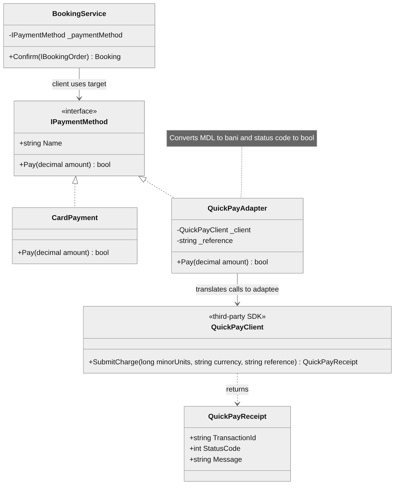
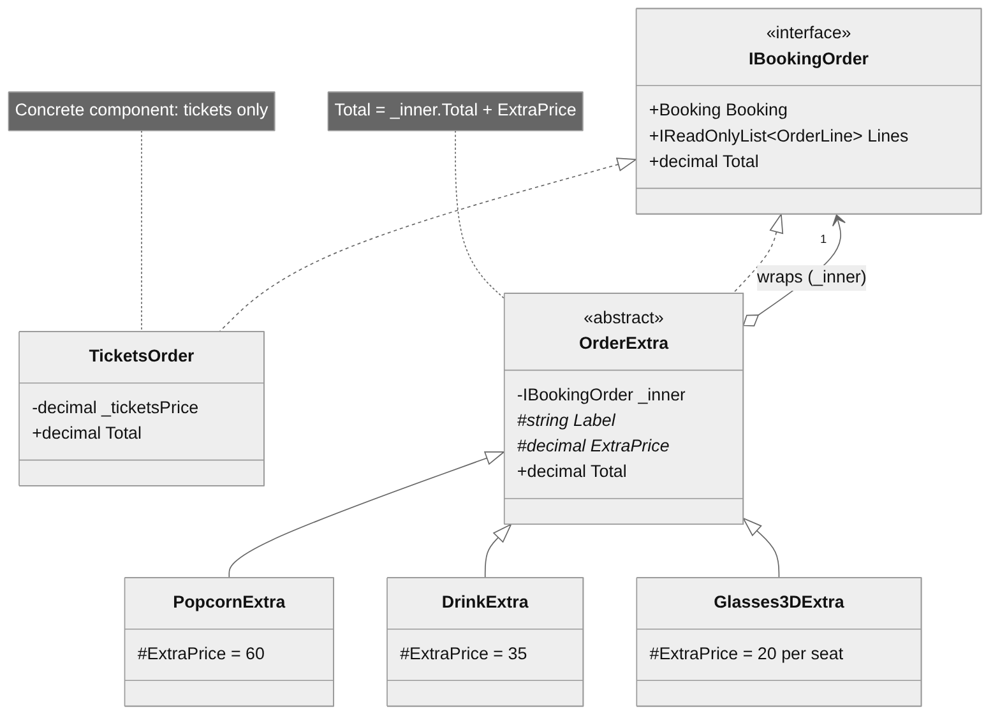
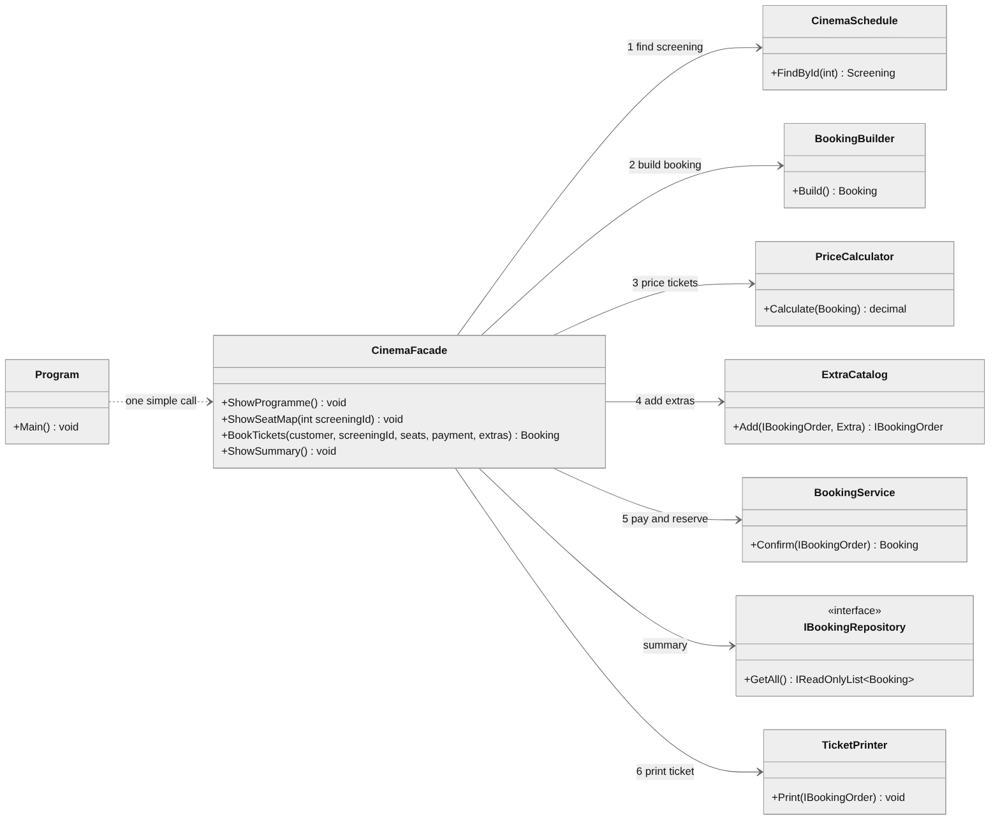

# Laboratory Work 2 — Structural Design Patterns

**Course:** Tehnici și Mecanisme de Proiectare Software (TMPS)
**Author:** Teodor Strulea, FAF-242
**Language:** C# (.NET 8)
**Project:** Cinema Booking System

## Objectives

1. Study the structural design patterns and understand what problem each one solves.
2. Choose three of them and implement them in the semester project.
3. Keep the existing code working: the new patterns must plug into the
   project instead of replacing it.

Patterns implemented in this laboratory work: **Adapter**, **Decorator** and **Facade**.

## Theory

Structural patterns describe how classes and objects are *composed* into
larger structures while keeping those structures flexible. Instead of
changing existing classes, they add a thin object between them: a translator
(Adapter), a wrapper that adds behaviour (Decorator), or a simplified front
door (Facade).

## The project

A cinema ticket booking system: customers pick a screening, choose seats, get
discounts applied, optionally add extras, pay, and receive a ticket.

```
CinemaBooking/
├── Program.cs                      composition root + demo of the three patterns
├── Domain/                         Movie, Screening, Seat, Customer, Booking
├── Halls/                          hall layouts that create the seats
├── Schedule/                       the cinema's screening schedule
├── Builders/                       BookingBuilder
├── Discounts/                      IDiscount and its implementations
├── Repositories/                   IBookingRepository, InMemoryBookingRepository
├── Services/                       PriceCalculator, TicketPrinter, BookingService
├── Payments/
│   ├── IPaymentMethod.cs
│   ├── CardPayment.cs
│   ├── PayPalPayment.cs
│   ├── QuickPayAdapter.cs          ADAPTER
│   └── External/
│       └── QuickPayClient.cs       the third-party SDK being adapted
├── Orders/                         DECORATOR
│   ├── IBookingOrder.cs            component (+ OrderLine)
│   ├── TicketsOrder.cs             concrete component
│   ├── OrderExtra.cs               base decorator
│   ├── PopcornExtra.cs             concrete decorators
│   ├── DrinkExtra.cs
│   ├── Glasses3DExtra.cs
│   └── Extra.cs                    Extra enum + ExtraCatalog
└── Facade/                         FACADE
    └── CinemaFacade.cs
```

## Implementation

### 1. Adapter — `QuickPayAdapter`

**Problem.** The cinema wants to accept payments through an external provider.
Its SDK (`QuickPayClient`, simulated in `Payments/External/`) cannot be
modified, and its API does not match what the application expects:

| The application expects (`IPaymentMethod`) | The SDK offers (`QuickPayClient`)                       |
|--------------------------------------------|---------------------------------------------------------|
| `bool Pay(decimal amount)`                 | `QuickPayReceipt SubmitCharge(long, string, string)`    |
| amount in MDL, as a `decimal`              | amount in bani, as a whole number                       |
| nothing else needed                        | a currency code and a merchant reference on every call  |
| success as `true` / `false`                | a receipt with a numeric status code                    |

Rewriting `BookingService` to call the SDK directly would tie the booking
flow to one provider.

**Solution.** `QuickPayAdapter` implements `IPaymentMethod` and holds a
`QuickPayClient`. It translates each call on the way in and the result on the
way out:

```csharp
public class QuickPayAdapter : IPaymentMethod
{
    private readonly QuickPayClient _client;
    private readonly string _reference;

    public bool Pay(decimal amount)
    {
        long minorUnits = (long)Math.Round(amount * 100m, MidpointRounding.AwayFromZero);
        QuickPayReceipt receipt = _client.SubmitCharge(minorUnits, "MDL", _reference);
        return receipt.StatusCode == 200;
    }
}
```

`BookingService` receives the adapter like any other payment method and
cannot tell the difference. This is the *object adapter* form: the adaptee is
a field, not a base class.

<p align="center"></p>

| Role    | Class             |
|---------|-------------------|
| Client  | `BookingService`  |
| Target  | `IPaymentMethod`  |
| Adapter | `QuickPayAdapter` |
| Adaptee | `QuickPayClient`  |

### 2. Decorator — order extras

**Problem.** Customers can add extras to a booking: popcorn, a drink, 3D
glasses, in any combination and quantity. Modelling this with inheritance
(`BookingWithPopcorn`, `BookingWithPopcornAndDrink`, ...) needs a class per
combination, and putting `bool hasPopcorn, int drinks, ...` fields into
`Booking` means editing it for every new product.

**Solution.** What the customer pays for is an `IBookingOrder`. The plain
tickets are one implementation (`TicketsOrder`). Each extra is another
implementation that *wraps* an `IBookingOrder` and adds its own line and
price on top:

```csharp
public abstract class OrderExtra : IBookingOrder
{
    private readonly IBookingOrder _inner;

    protected abstract string Label { get; }
    protected abstract decimal ExtraPrice { get; }

    public Booking Booking => _inner.Booking;
    public IReadOnlyList<OrderLine> Lines => _inner.Lines.Append(new OrderLine(Label, ExtraPrice)).ToList();
    public decimal Total => _inner.Total + ExtraPrice;
}

public class PopcornExtra : OrderExtra
{
    public PopcornExtra(IBookingOrder inner) : base(inner) { }
    protected override string Label => "Large popcorn";
    protected override decimal ExtraPrice => 60m;
}
```

Extras are stacked at run time, in any order, and the same one can be applied
more than once:

```csharp
IBookingOrder order = new TicketsOrder(booking, ticketsPrice);
order = new PopcornExtra(order);
order = new DrinkExtra(order);
order = new DrinkExtra(order);
order = new Glasses3DExtra(order);   // priced per seat, read from the wrapped order
```

`BookingService` and `TicketPrinter` work only with `IBookingOrder`, so they
handle an order with zero extras or ten extras with the same code. A new
extra is one small class; nothing existing changes.

<p align="center"></p>

| Role                | Class                                           |
|---------------------|-------------------------------------------------|
| Component           | `IBookingOrder`                                 |
| Concrete component  | `TicketsOrder`                                  |
| Decorator           | `OrderExtra`                                    |
| Concrete decorators | `PopcornExtra`, `DrinkExtra`, `Glasses3DExtra`  |

### 3. Facade — `CinemaFacade`

**Problem.** Buying a ticket takes seven collaborating objects in a fixed
sequence: find the screening in `CinemaSchedule`, assemble the booking with
`BookingBuilder`, price it with `PriceCalculator`, wrap it in extras, confirm
it through `BookingService` (which pays and saves through
`IBookingRepository`), and print it with `TicketPrinter`. Every client
(the console demo now, a GUI or web API later) would have to repeat that
sequence and know all of those classes.

**Solution.** `CinemaFacade` knows the sequence and exposes it as one call:

```csharp
var cinema = new CinemaFacade(priceCalculator, repository, printer);

cinema.BookTickets(
    maria,
    1,                                      // screening id
    new[] { "B3", "C3" },                   // seats
    new CardPayment("4111222233334444"),    // any IPaymentMethod
    Extra.Popcorn, Extra.Drink, Extra.Glasses3D);
```

It also offers `ShowProgramme()`, `ShowSeatMap(id)` and `ShowSummary()`. The
facade contains no business rules of its own; it only coordinates. Errors from
the subsystem (unknown screening, taken seat, failed payment) pass through
unchanged, and the subsystem classes stay public for anything the facade does
not cover.

<p align="center"></p>

| Role      | Class                                                                                                        |
|-----------|--------------------------------------------------------------------------------------------------------------|
| Client    | `Program`                                                                                                    |
| Facade    | `CinemaFacade`                                                                                               |
| Subsystem | `CinemaSchedule`, `BookingBuilder`, `PriceCalculator`, `ExtraCatalog`, `BookingService`, `IBookingRepository`, `TicketPrinter` |

### How the three work together

In one `BookTickets` call the facade builds a `TicketsOrder`, wraps it in the
requested decorators, and hands it to `BookingService` together with a
payment method that may be the QuickPay adapter. Each pattern hides one kind
of detail from the others: the facade hides the *sequence*, the decorator
hides *how many extras* there are, and the adapter hides *whose API* takes the
money.

## Results

Requires the [.NET 8 SDK](https://dotnet.microsoft.com/download) or newer.

```bash
cd CinemaBooking
dotnet run
```

The demo has three parts:

1. **Decorator** — wraps a tickets order one extra at a time and prints the
   total after each layer, then the full list of receipt lines.
2. **Adapter** — calls the SDK directly to show its API, pays for a booking
   through `QuickPayAdapter`, then attempts a booking above the provider's
   500 MDL limit: the SDK returns status 402, the adapter turns it into
   `false`, and the seats stay free.
3. **Facade** — books two seats with three extras in a single call, prints the
   seat map, and shows two invalid requests being rejected.

## Conclusions

- **Adapter** let the project use a third-party payment API without changing
  either side. The cost is one small class, and replacing the provider later
  means writing another adapter, not touching the booking flow.
- **Decorator** replaced a potential explosion of subclasses or flags with
  small wrappers that are combined at run time. It works because every wrapper
  keeps the interface of what it wraps.
- **Facade** reduced the client's knowledge of the system from seven classes
  and their call order to one method. It makes the common case easy without
  hiding the subsystem from code that needs more control.
- All three patterns relied on abstractions already in the project
  (`IPaymentMethod`, `IBookingRepository`), which is what made it possible to
  add them without rewriting existing classes.
